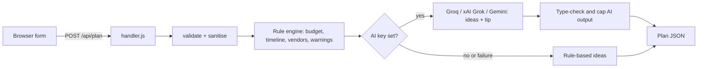

# Festa: GenAI Event Planning Assistant

Plans **weddings, birthdays and community events**: budget split, dated timeline, vendor checklist and personalised ideas.

- **Live demo:** https://festa-orcin.vercel.app
- **Chosen vertical:** Event planning (wedding / birthday / community persona, chosen by the user)

## How it works

1. The user enters type, date, guests, budget, currency and optional city, theme and notes.
2. `planner.js` validates the input and the **rule engine** builds the plan:
   - Budget split per event type (shares sum to 100%, includes contingency).
   - Timeline counted back from the event date; past-due tasks are flagged **Do now**.
   - Vendor checklist per event type, extended from notes (vegetarian, outdoor, elderly guests, kids).
   - Warnings for short lead time and low budget per guest (currency-scaled).
3. If `GROQ_API_KEY`, `XAI_API_KEY` or `GEMINI_API_KEY` is set (checked in that order), the LLM writes ideas and a budget tip from the user's city, theme, notes and budget per guest. Output is parsed as JSON, type-checked and length-capped. On any AI failure the rule-based plan is returned, so the app always works.

## Run
```bash
npm test                      # Node 18+, no dependencies
npm start                     # http://localhost:3000
GROQ_API_KEY=... npm start    # or XAI_API_KEY / GEMINI_API_KEY
```
Deploy: Vercel (`api/plan.js`, `vercel.json`) or Docker. Copy `.env.example` for variables.

## Structure
| File | Role |
|---|---|
| `planner.js` | Validation, rule engine, AI adapters (pure logic) |
| `handler.js` | One request handler shared by both runtimes |
| `server.js` / `api/plan.js` | Node server (rate limit, headers) / Vercel function |
| `public/` | Accessible UI (no framework, no `innerHTML`) |
| `test/` | `node:test` suite; CI in `.github/workflows/ci.yml` |

## Evaluation criteria
- **Code quality:** zero dependencies, pure logic separated from transport, one shared handler, no duplication.
- **Security:** input sanitising, 8 KB body limit, per-IP rate limit on the Node server, strict CSP, API keys only from env, user text sent to the model as data, UI built with `textContent`.
- **Efficiency:** rules run instantly; one optional AI call with an 8 s timeout.
- **Testing:** unit and API tests for validation, budget maths, timeline, warnings, note rules, AI merge and fallback, provider adapters, and static accessibility checks; runs in CI.
- **Accessibility:** labelled fields, `lang`, skip link, `aria-live` results, visible focus, text values beside every bar, reduced motion, responsive, printable.
- **Problem alignment:** budgets, timelines, vendor checklists and personalised ideas for three event types.

## Assumptions and limits
Budget shares and lead times are typical Indian-market defaults. Per-guest floors are INR-based and scaled for other currencies. No user data is stored on the server. On Vercel the in-memory rate limit does not apply (serverless); use Vercel Firewall rate limiting for production.
